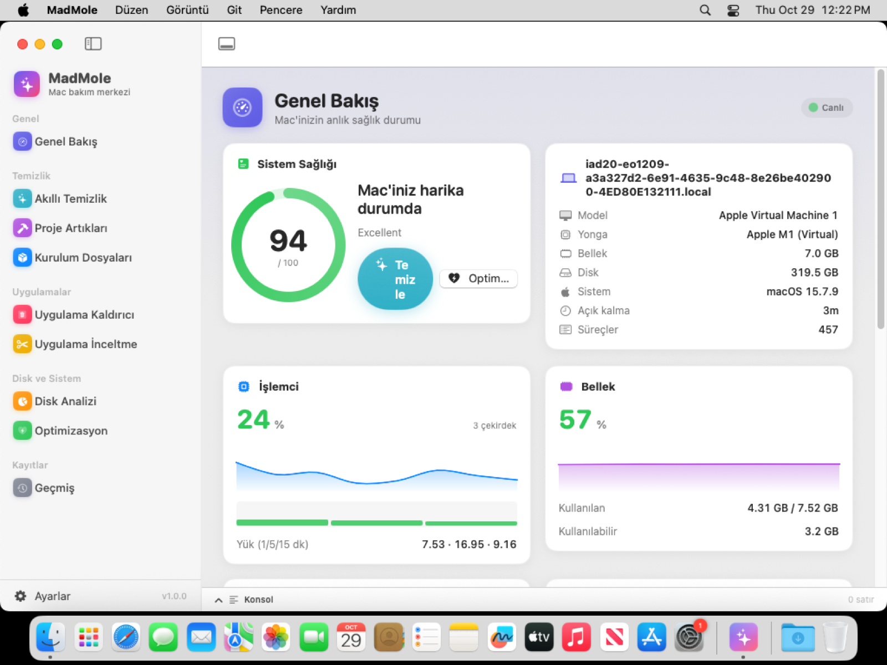
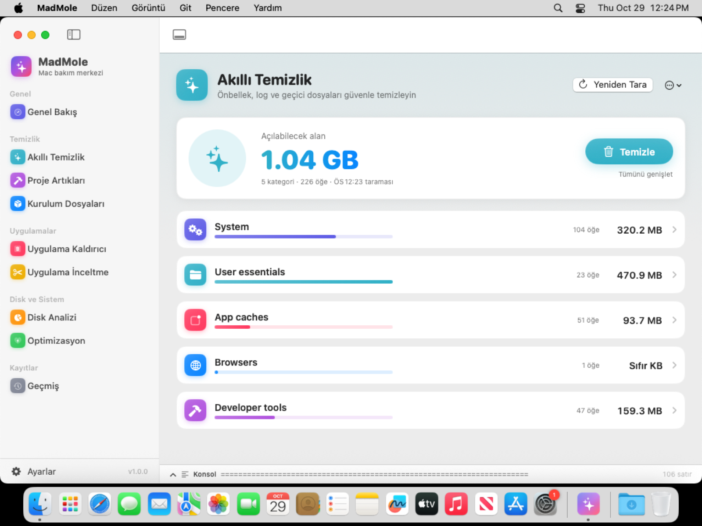
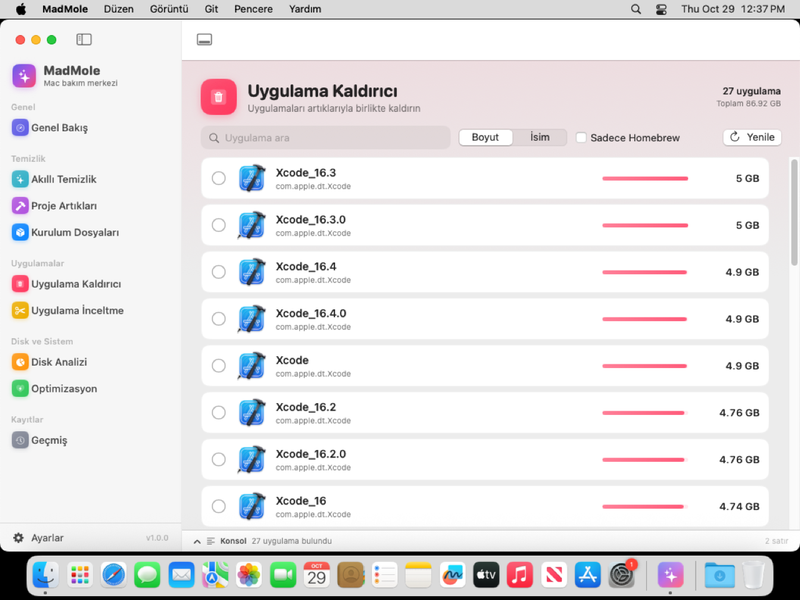
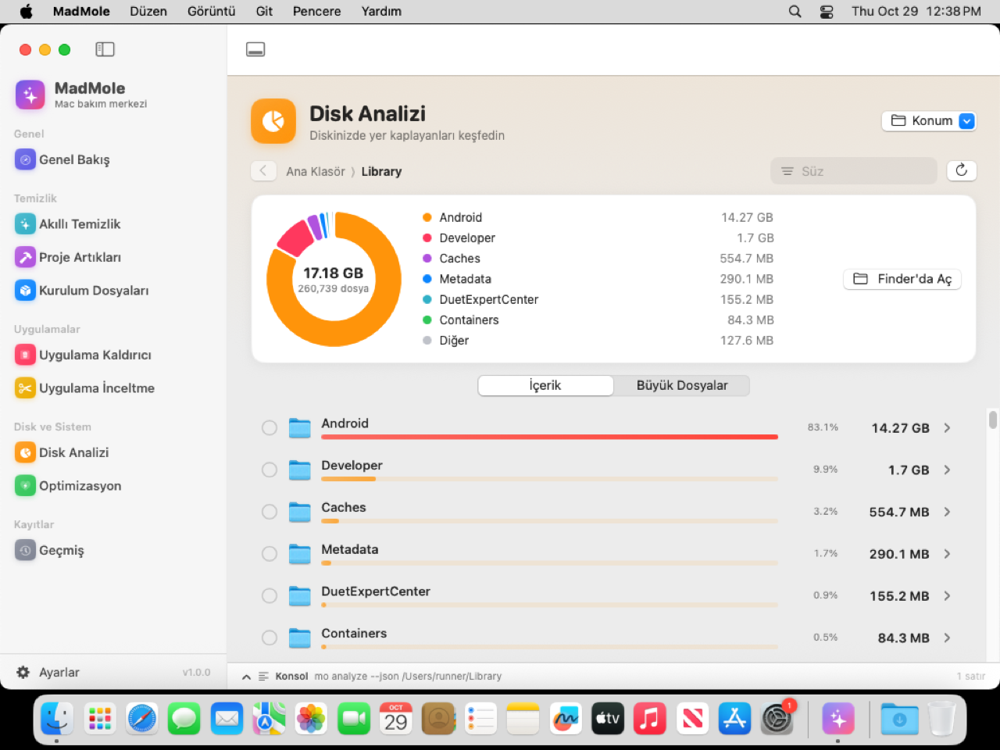

# MadMole.app

Mole temizlik motorunun Apple Silicon için yerel (SwiftUI) macOS arayüzü.

Uygulama, bu depodaki kabuk + Go motorunu paketin içine gömer ve onu çalıştırır.
Silme işlemlerinin tamamı motorun kendi güvenlik kurallarından (korunan yollar,
`mole_delete` hunisi, kuru çalıştırma önizlemesi, işlem kayıtları) geçer;
arayüz bu kuralları yeniden yazmaz.

<p align="center">
  
  
  
  
</p>

Ekran görüntüleri CI'da gerçek bir macOS sanal makinesinde alınır; Actions
sekmesinden **App** iş akışını `publish_screenshots` seçeneğiyle elle
çalıştırarak `app/screenshots/` klasörünü yenileyebilirsiniz.

## Ekranlar

| Ekran | Ne yapar | Motor komutu |
| --- | --- | --- |
| Genel Bakış | Sağlık puanı, CPU, bellek, disk, ağ, pil, ısı ve en çok kaynak kullanan süreçler, canlı | `status-go --watch` |
| Akıllı Temizlik | Önce hiçbir şey silmeden tarar, kategorilere göre açılabilecek alanı gösterir, sonra temizler | `mo clean --dry-run`, `mo clean` |
| Uygulama Kaldırıcı | Yüklü uygulamaları ikon ve boyutlarıyla listeler; seçtiklerinizi artıklarıyla kaldırır | `mo uninstall --list`, `mo uninstall …` |
| Disk Analizi | Klasörleri boyuta göre sıralar, halka grafikle gösterir, içine girer, Finder'da gösterir, Çöp'e taşır | `analyze-go --json`, `analyze-go --trash` |
| Optimizasyon | Sistem önbelleklerini ve servislerini tazeler | `mo optimize` |
| Proje Artıkları | Eski `node_modules`, `target`, `build` klasörleri | `mo purge` |
| Kurulum Dosyaları | `.dmg`, `.pkg`, `.iso`, `.xip`, `.zip` | `mo installer` |
| Uygulama İnceltme | Evrensel uygulamalardan Intel kodunu çıkarır | `mo slim` |
| Geçmiş | Yapılan her işlem ve silinen her öğe | `mo history --json` |
| Ayarlar | Görünüm (Sistem/Açık/Koyu), Tam Disk Erişimi, korunan yollar, Touch ID | `mo clean --whitelist`, `mo touchid` |

Gerçek değişiklik yapan her işlem (temizlik, kaldırma, optimizasyon…) uygulama
içinde açılan bir **terminal penceresinde** çalışır. Böylece motorun kendi onay
ekranları, seçim listeleri ve yönetici şifresi / Touch ID istemi aynen korunur.
Önizlemeler ve taramalar ise terminalsiz çalışır ve sonuçları yerel arayüzde
gösterilir; ham çıktı alttaki **Konsol** panelinde (⌘J) görülebilir.

## Derleme

Gereksinimler: Apple Silicon Mac, macOS 14 (Sonoma) veya üstü, Xcode ya da
Command Line Tools (`xcode-select --install`) ve Go (`brew install go`).

```bash
./scripts/build_app.sh
```

```bash
./scripts/build_app.sh --install
```

`--install` uygulamayı `/Applications` klasörüne kopyalar ve açar; `--dmg`
ayrıca `dist/MadMole.dmg` oluşturur. Çıktı: `app/.build/MadMole.app`.

Her push'ta GitHub Actions (`.github/workflows/app.yml`) uygulamayı derler ve
`MadMole-dmg` adlı bir artefakt yükler. İndirilen uygulama ad-hoc imzalı
olduğu için ilk açılışta Gatekeeper uyarır; Finder'da sağ tıklayıp **Aç**
deyin ya da:

```bash
xattr -dr com.apple.quarantine /Applications/MadMole.app
```

## İlk açılış

En iyi sonuç için **Sistem Ayarları › Gizlilik ve Güvenlik › Tam Disk Erişimi**
listesine MadMole'u ekleyin. Genel Bakış ekranı izin yoksa bunu hatırlatır.

## Geliştirme

Arayüz Swift Package Manager ile yazıldı (`app/Package.swift`). Paketlenmemiş
bir derlemeyi depo motoruna yönlendirmek için:

```bash
make build
```

```bash
MADMOLE_ENGINE_DIR="$PWD" swift run --package-path app
```

Klasörler: `Engine/` motoru bulur ve çalıştırır, `Stores/` ekran durumlarını
tutar, `Views/` ekranları, `UI/` ortak bileşenleri, tema, konsol ve gömülü
terminali (SwiftTerm) içerir.

Arayüz tasarımında açık kaynak SwiftUI Mac temizleyicisi
[Pearcleaner](https://github.com/alienator88/Pearcleaner)'daki fikirlerden
(başlıklı kart kutuları, alttan açılan konsol, büyük ikonlu uygulama listesi)
esinlenildi; kod kopyalanmadı.

## Ad

Mole'un ticari marka politikası (`TRADEMARK.md`) çatalların kendi adını ve
ikonunu kullanmasını istiyor. Uygulamayı herkese açık dağıtacaksanız "Mole"
içermeyen bir ad seçmeniz önerilir.
