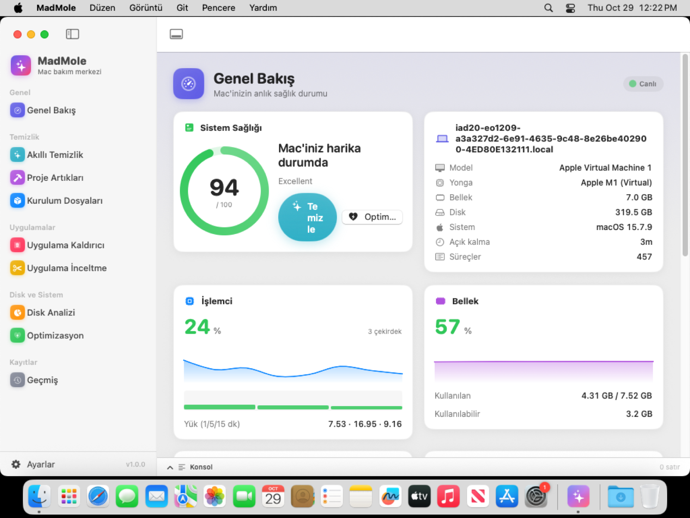
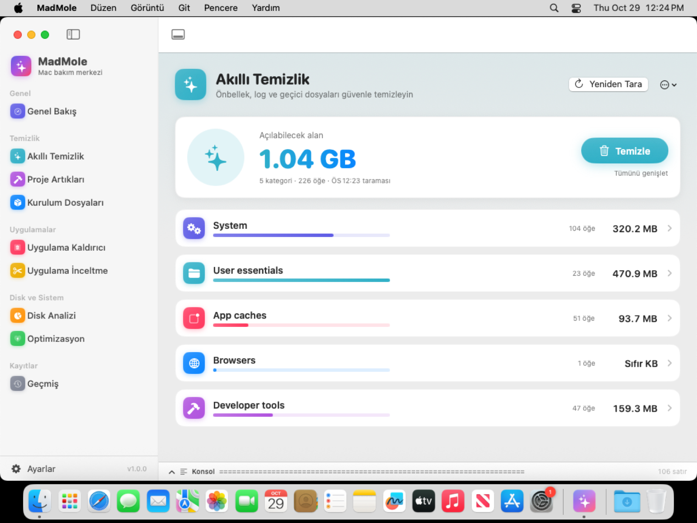
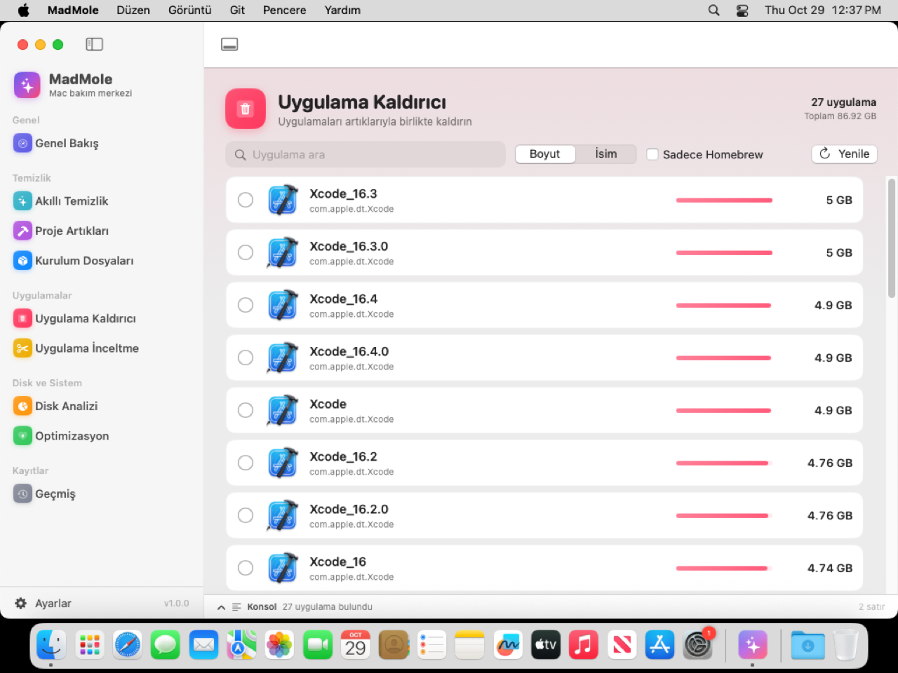
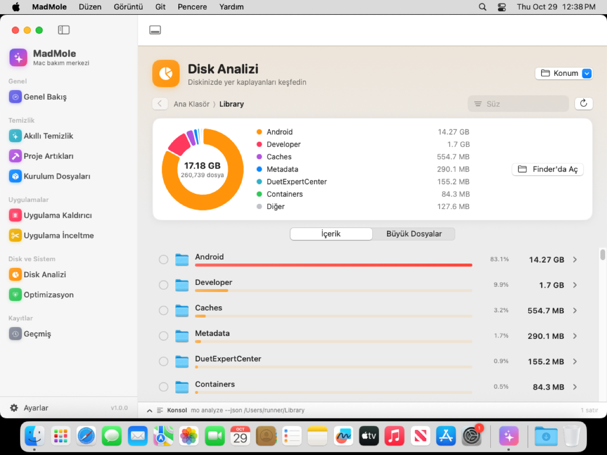

# MadMole.app

Mole temizlik motorunun Apple Silicon için yerel (SwiftUI) macOS arayüzü.

Uygulama, bu depodaki kabuk + Go motorunu paketin içine gömer ve onu çalıştırır.
Silme işlemlerinin tamamı motorun kendi güvenlik kurallarından (korunan yollar,
`mole_delete` hunisi, kuru çalıştırma önizlemesi, işlem kayıtları) geçer;
arayüz bu kuralları yeniden yazmaz.

<p align="center">
  
  
  
  
</p>

Ekran görüntüleri CI'da gerçek bir macOS sanal makinesinde alınır; Actions
sekmesinden **App** iş akışını `publish_screenshots` seçeneğiyle elle
çalıştırarak `app/screenshots/` klasörünü yenileyebilirsiniz.

## Ekranlar

| Ekran | Ne yapar | Motor komutu |
| --- | --- | --- |
| Genel Bakış | Sağlık puanı, CPU, bellek, disk, ağ, pil, ısı ve en çok kaynak kullanan süreçler, canlı | `status-go --watch` |
| Akıllı Temizlik | Önce hiçbir şey silmeden tarar, kategorilere göre açılabilecek alanı gösterir, sonra temizler | `mo clean --dry-run`, `mo clean` |
| Uygulama Kaldırıcı | Yüklü uygulamaları ikonlarıyla listeler; her uygulamanın program boyutunu ve kaydettiği verinin boyutunu ayrı sütunlarda gösterir; seçtiklerinizi artıklarıyla kaldırır | `mo uninstall --list`, `find_app_files`, `mo uninstall …` |
| Sahipsiz Artıklar | Uygulaması artık yüklü olmayan veri klasörlerini, programı kalmamış açılış kayıtlarını, yarım kalmış kurulumları ve Sparkle güncelleme artıklarını önerir; yalnızca seçtiklerinizi Çöp'e taşır | `scan_installed_apps`, `is_bundle_orphaned`, `mole_delete` |
| Disk Analizi | Klasörleri boyuta göre sıralar, halka grafikle gösterir, içine girer, Finder'da gösterir, Çöp'e taşır | `analyze-go --json`, `analyze-go --trash` |
| Harici Diske Taşı | Bir klasörü ya da dosyayı harici diske `ditto` ile kopyalar, her dosyayı baytı baytına karşılaştırır, ancak hepsi aynıysa aslını Çöp'e taşır; hedefte aynı ad varsa durur, şifresiz diskte uyarır | `ditto`, `mole_delete` |
| Optimizasyon | Sistem önbelleklerini ve servislerini tazeler | `mo optimize` |
| Proje Artıkları | Eski `node_modules`, `target`, `build` klasörleri | `mo purge` |
| Kurulum Dosyaları | `.dmg`, `.pkg`, `.iso`, `.xip`, `.zip` | `mo installer` |
| Uygulama İnceltme | Evrensel uygulamalardan Intel kodunu çıkarır | `mo slim` |
| Geçmiş | Yapılan her işlem ve silinen her öğe | `mo history --json` |
| Ayarlar | Görünüm (Sistem/Açık/Koyu), Tam Disk Erişimi, korunan yollar, Touch ID | `mo clean --whitelist`, `mo touchid` |

Harici Diske Taşı, Sahipsiz Artıklar ve veri sütunu, motorun kurallarına
`madmole-helper.sh` üzerinden sorar (paketin içinde motorun yanında durur):
korunan yollar (`~/.config/mole/whitelist`) ve içinde korunan yol olan klasörler
reddedilir, `validate_path_for_deletion` uygulanır, Çöp'e taşıma `mole_delete`
hunisinden geçer ve **Geçmiş**'e `madmole-move` / `madmole-leftovers` adıyla
yazılır. Hiçbir şey kalıcı olarak silinmez. Yüklü uygulamaların listesi eksiksiz
çıkarılamazsa (örneğin içinde uygulama bilgisi olmayan bozuk bir `.app`)
Sahipsiz Artıklar `mo clean` gibi hiçbir klasöre "sahipsiz" demeden durur.

Gerçek değişiklik yapan her işlem (temizlik, kaldırma, optimizasyon…) uygulama
içinde açılan bir **terminal penceresinde** çalışır. Böylece motorun kendi onay
ekranları, seçim listeleri ve yönetici şifresi / Touch ID istemi aynen korunur.
Önizlemeler ve taramalar ise terminalsiz çalışır ve sonuçları yerel arayüzde
gösterilir; ham çıktı alttaki **Konsol** panelinde (⌘J) görülebilir.

## Kurulum ve güncelleme

1. [Sürümler sayfasından](https://github.com/madduck666/MadMole/releases) en
   yeni **MadMole 1.0.x** sürümünün `MadMole.dmg` dosyasını indirin.
2. DMG'yi açın, **MadMole**'u **Applications** klasörüne sürükleyin.
3. İlk açılışta Finder'da MadMole'a sağ tıklayıp **Aç** deyin. Uygulama
   ücretli bir Apple sertifikasıyla değil, depoya eklenen kendi sertifikanızla
   imzalanır; macOS bu yüzden ilk açılışta bir kez onay ister.

Bundan sonra DMG'ye gerek yok. Depoya her değişiklik gönderildiğinde GitHub
Actions (`.github/workflows/app.yml`) yeni bir sürüm yayınlar
(`madmole-<numara>` etiketiyle). Uygulama açılışta yeni sürümü denetler ve kenar
çubuğunda **Güncelleme hazır** gösterir; ayrıca **MadMole › Güncellemeleri
Denetle…** menüsü ve **Ayarlar › Güncellemeler** kartı vardır.
**Güncelle ve Yeniden Başlat** dediğinizde uygulama:

- yeni sürümü indirir ve SHA-256 özetini doğrular,
- paket kimliğini, sürüm numarasını, Mole motorunu ve kod imzasını denetler,
- kendini kapatır, eski kopyayı yeni kopya yerine oturana kadar yedekte tutar,
  sonra yeni sürümü açar. Kopyalama başarısız olursa eski sürüm geri konur.

Güncelleme, uygulama Uygulamalar klasöründeyken çalışır; DMG'nin içinden
açılmış bir kopya kendini güncelleyemez.

### İzinlerin güncellemelerde korunması (bir kerelik)

macOS, Tam Disk Erişimi ve Uygulama Yönetimi izinlerini uygulamanın imzasına
bağlar. Geçici (ad hoc) imza her derlemede değiştiği için izinler her
güncellemede düşer. Bunu önlemek için depoya bir kez kendi imza sertifikanızı
ekleyin; gizli anahtar yalnızca kendi Mac'inizde üretilir ve GitHub'ın gizli
değişkenlerinde saklanır.

1. Mac'te Terminal'i açıp şunu çalıştırın; sertifika üretilir ve panoya
   kopyalanır:

   ```bash
   cd "$(mktemp -d)" && printf '[req]\ndistinguished_name=dn\nx509_extensions=ext\nprompt=no\n[dn]\nCN=MadMole Code Signing\n[ext]\nbasicConstraints=critical,CA:false\nkeyUsage=critical,digitalSignature\nextendedKeyUsage=critical,codeSigning\n' > cert.cnf && /usr/bin/openssl req -x509 -newkey rsa:2048 -nodes -keyout key.pem -out cert.pem -days 3650 -config cert.cnf && /usr/bin/openssl pkcs12 -export -inkey key.pem -in cert.pem -name "MadMole Code Signing" -out madmole.p12 -passout pass:madmole && base64 -i madmole.p12 | pbcopy && rm key.pem && echo "Hazir: sertifika panoya kopyalandi"
   ```

2. GitHub'da depo › **Settings › Secrets and variables › Actions › New
   repository secret**: Name `MADMOLE_SIGNING_P12`, Secret alanına panodakini
   yapıştırın, **Add secret**.

Bundan sonraki her sürüm bu sertifikayla imzalanır. Bu sürüme geçtikten sonra
Tam Disk Erişimi'ni son bir kez yeniden vermeniz yeter; güncelleyici de yeni
sürümü yalnızca aynı sertifikayla imzalanmışsa kurar.

## Kaynaktan derleme (isteğe bağlı)

Gereksinimler: Apple Silicon Mac, macOS 14 (Sonoma) veya üstü, Xcode ya da
Command Line Tools (`xcode-select --install`) ve Go (`brew install go`).

```bash
./scripts/build_app.sh --install
```

`--install` uygulamayı `/Applications` klasörüne kopyalar ve açar; `--dmg`
`dist/MadMole.dmg`, `--zip` güncelleme paketi `dist/MadMole.zip` üretir.
Yerelde derlenen kopyanın build numarası 0'dır, bu yüzden yayınlanmış her sürüm
ona güncelleme olarak görünür.

## İlk açılış

En iyi sonuç için **Sistem Ayarları › Gizlilik ve Güvenlik › Tam Disk Erişimi**
listesine MadMole'u ekleyin. Genel Bakış ekranı izin yoksa bunu hatırlatır.

## Geliştirme

Arayüz Swift Package Manager ile yazıldı (`app/Package.swift`). Paketlenmemiş
bir derlemeyi depo motoruna yönlendirmek için:

```bash
make build
```

```bash
MADMOLE_ENGINE_DIR="$PWD" swift run --package-path app
```

Mantık testleri (taşıma ve karşılaştırma, korunan yollar, Çöp hunisi, veri
listesi, artık kuralları) yalnızca Command Line Tools ile çalışır; Çöp'e taşıma
denemeleri sahte bir ana klasörde ve motorun test Çöp'ünde yapılır:

```bash
app/Tests/run_logic_tests.sh
```

Klasörler: `Engine/` motoru bulur ve çalıştırır, `Stores/` ekran durumlarını
tutar, `Views/` ekranları, `UI/` ortak bileşenleri, tema, konsol ve gömülü
terminali (SwiftTerm) içerir.

Arayüz tasarımında açık kaynak SwiftUI Mac temizleyicisi
[Pearcleaner](https://github.com/alienator88/Pearcleaner)'daki fikirlerden
(başlıklı kart kutuları, alttan açılan konsol, büyük ikonlu uygulama listesi)
esinlenildi; kod kopyalanmadı.

## Ad

Mole'un ticari marka politikası (`TRADEMARK.md`) çatalların kendi adını ve
ikonunu kullanmasını istiyor. Uygulamayı herkese açık dağıtacaksanız "Mole"
içermeyen bir ad seçmeniz önerilir.
